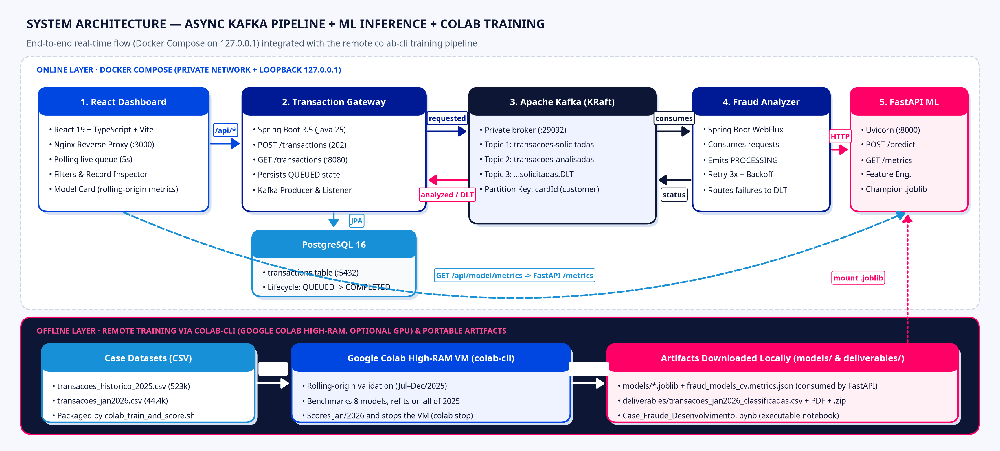
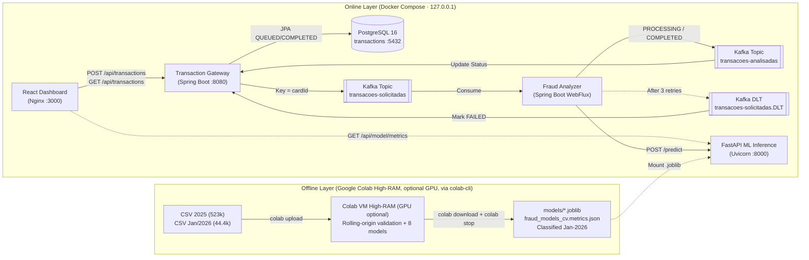
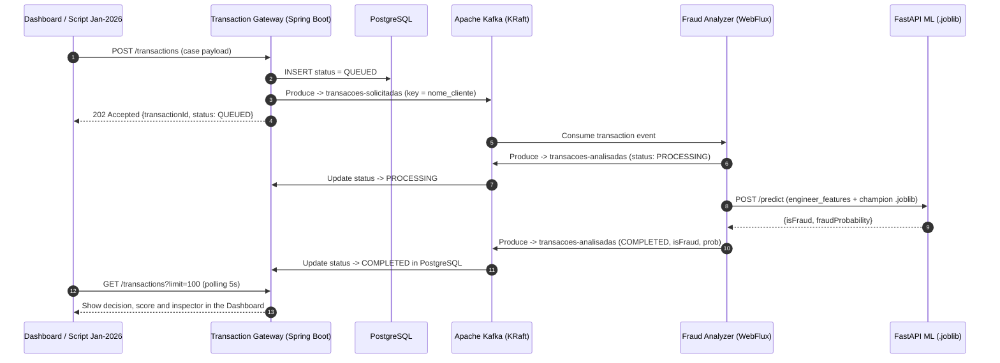
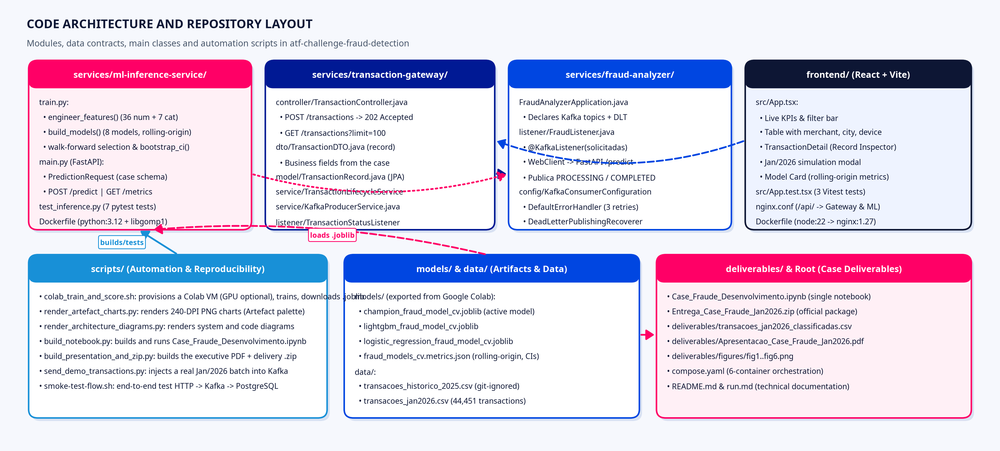
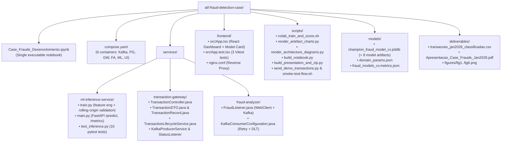

# System and Code Architecture — ATF Fraud Detection Case

**Repository:** https://github.com/leorossi08/atf-challenge-fraud-detection

This document presents the architecture diagrams of the event-driven system (Kafka + Microservices + FastAPI + React) and the structure of the code and the remote training flow on Google Colab (`colab-cli`).

---

## 1. System Architecture (Real Time + Remote Colab Training)

---

## 2. Transaction Lifecycle (Sequence Diagram)

---

## 3. Code Architecture and Project Structure

